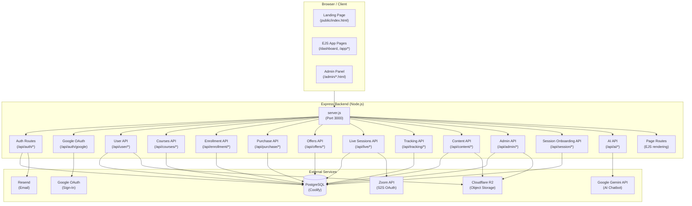
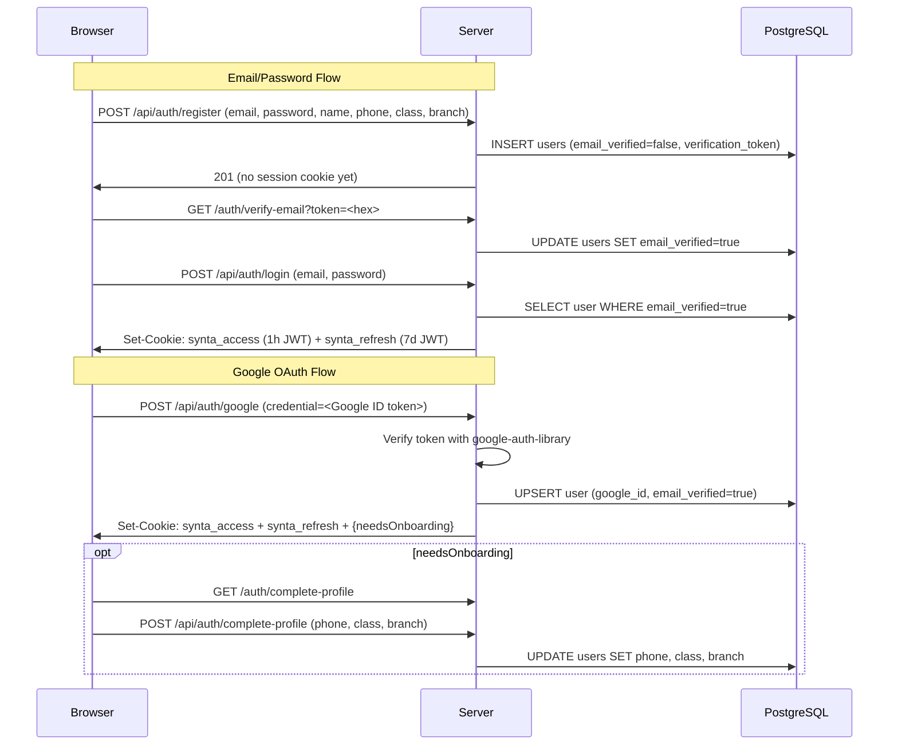

# ARCHITECTURE.md — Synta Academy

> **Last audited:** 2026-11-05  
> **Audited by:** Senior Software Architect (AI documentation audit)  
> **Status:** Reflects ACTUAL codebase — not aspirational

---

## 1. Project Overview

Synta Academy is a **Tunisian e-learning platform** targeting high-school students (Bac Informatique, Bac Mathématiques, etc.) and their parents. It sells structured courses (video + PDF + quiz), bundled as "Offers", with live Zoom sessions for enrolled students. The platform is built in **French/Arabic** (UI multilingual) and uses **Tunisian Dinars (TND)** as currency.

**Core value propositions:**
- Self-paced course content (video, PDF, quizzes)
- Live Zoom sessions for enrolled students
- Internal wallet system for balance/purchases
- Admin-managed student enrollment and payment confirmation
- AI code debugger ("Bugi") for Bac Informatique students
- Pre-enrollment scoring session (placement quiz)

---

## 2. Technology Stack

### Backend
| Component | Technology | Version |
|-----------|-----------|---------|
| Runtime | Node.js | ≥18.x |
| Framework | Express.js | ^4.18.2 |
| Database ORM | Raw SQL via `pg` | ^8.23.0 |
| Authentication | JWT (jsonwebtoken) | ^9.0.3 |
| Password hashing | bcrypt | ^6.0.0 |
| Template engine | EJS | ^6.0.1 |
| Email | Resend | ^6.28.1 |
| AI integration | @google/genai (Gemini) | ^2.23.0 |
| Cookie handling | cookie-parser | ^1.4.7 |
| Security headers | Helmet | ^7.1.0 |
| CORS | cors | ^2.8.5 |
| OAuth | google-auth-library | ^11.1.0 |
| Object storage SDK | @aws-sdk/client-s3 | ^3.490.0 |
| Signed URLs | @aws-sdk/s3-request-presigner | ^3.490.0 |

### Database
| Component | Technology |
|-----------|-----------|
| Database | PostgreSQL (self-hosted via Coolify) |
| Client | `pg` (node-postgres) Pool |
| Migrations | Versioned SQL files in `/database/migrations/`, applied by the container before app start |

### Storage
| Component | Technology |
|-----------|-----------|
| Object storage | Cloudflare R2 (S3-compatible) |
| Access method | Pre-signed URLs (5-minute expiry default) |
| Content types | MP4 video, PDF, images (thumbnails, receipts) |
| Admin uploads | Short-lived signed R2 PUT URLs; lesson documents are stored in `lessons.pdf_key`, uploaded live replays reuse `live_sessions.replay_url` to store a private R2 object key |

### Frontend
| Component | Technology |
|-----------|-----------|
| Landing page | Static HTML (`backend/public/index.html`) |
| App pages | EJS templates (`backend/views/`) |
| Styling | Custom CSS (no framework) |
| Client JS | Vanilla JavaScript (no bundler/framework) |
| Admin panel | Static HTML + vanilla JS (`admin/`) |

### Student course visibility

The published course catalog and course-detail API filter offer-linked courses using the authenticated student's `users.class` and `users.branch`, and only consider active offers inside their validity window. A course linked to several offers appears when at least one active offer matches. A student with an active enrollment can continue to see that course even if targeting later changes. Published courses with no `offer_courses` association remain open in the catalog for public/free formations such as AI or web development. Course enrollment checks continue to govern actual lesson access.

### Interactive chapter quizzes

Lessons store an optional structured payload in `lessons.content` (JSONB). Interactive quizzes have exactly three questions and support `multiple_choice`, `true_false`, `code_drag_drop`, `ordering`, and `matching`. Admins create/edit them in the chapter manager and reorder them among lessons; students load payloads through the authenticated lesson-content endpoint and complete the quiz in the course page. Migration `202611050003_add_lesson_quiz_content.sql` adds the column.

### Lesson and live-session practice files

Admins can attach multiple common teaching resources to a lesson or live session in one multi-file selection: PDF and office documents, slides, spreadsheets, images, text/notes, programming source files, and ZIP archives. Uploads use short-lived R2 PUT URLs; `learning_resources` stores metadata and private object keys. Entitled students receive expiring signed links. Legacy single-PDF lesson attachments and new resources are displayed together in one compact lesson resource section; PDFs can be previewed or downloaded, and Python exercises can open in Code Pratique. Authenticated lesson and session Python-source endpoints read small .py objects server-side, so editor loading does not depend on browser-to-R2 CORS. Live-session resources appear in the replay player. Uploads remain limited to 25 MB per file and editor loading to 1 MB. Migration `202611050004_create_learning_resources.sql` creates the resource table.

### Infrastructure
| Component | Technology |
|-----------|-----------|
| Containerization | Docker (multi-stage, Node 20 Alpine) |
| Deployment | Coolify (self-hosted PaaS) |
| DNS/CDN | Cloudflare |
| Live sessions | Zoom (Server-to-Server OAuth) |
| Zoom token caching | In-memory (1-hour lifetime) |

---

## 3. High-Level System Architecture



---

## 4. Frontend Architecture

### Structure
The frontend is a **hybrid architecture** mixing static HTML and EJS templates:

```
backend/public/          ← Static assets served directly
  index.html             ← Landing/home page
  Accueil.html           ← Alternative landing (French)
  admin/                 ← Admin panel (static HTML + vanilla JS)
  js/                    ← Client-side JavaScript
  css/                   ← Stylesheets
  source/                ← Images, icons

backend/views/           ← EJS templates (server-rendered)
  pages/
    auth/                ← login, register, verify-email, complete-profile, password-reset
    dashboard/           ← Student dashboard
    courses/             ← Course list + details
    calendar/            ← Event calendar
    profile/             ← User profile
    wallet/              ← Balance / payment page
    offers/              ← Offer listing
    contact/             ← Contact form
    code/                ← Python code editor (Bugi AI)
    session/             ← Onboarding placement quiz
  partials/
    head.ejs             ← HTML head
    header.ejs           ← Navigation header
    sidebar.ejs          ← Sidebar
```

### Client-side JavaScript (vanilla)
Key files in `backend/public/js/`:
- `api-client.js` — Thin HTTP wrapper for all API calls
- `auth.js` / `authentication.js` — Login/register logic, session management
- `dashboard.js` — Dashboard data loading
- `courses.js` / `course-details.js` — Course browsing and lesson player
- `offers.js` — Offer listing and purchase
- `paiement.js` — Wallet top-up with receipt upload
- `profile.js` — Profile editing
- `calendar.js` — Event/live session calendar
- `chatbot.js` — Bugi AI code debugger UI
- `google-auth.js` — Google Sign-In integration
- `session.js` — Onboarding quiz flow
- `offers-config.js` — Static offer configuration data

### Student course navigation and player
Authenticated app navigation uses Turbo Drive from the shared head partial; the six student navigation destinations remain in the shared sidebar. Course detail data is fetched by `course-details.js`. Course structure and access checks run concurrently, followed by concurrent session, resource, and progress reads when the student has access. Lesson and replay media share the course main area. Lesson playback has chapter navigation; replay playback replaces that sidebar with the student's month-grouped replay list and switches recordings in place. Player controls return to the matching course panel. Lesson position is restored from the authenticated lesson-content response and saved periodically/on pause through `POST /api/tracking/position`; that endpoint checks preview/enrollment access and updates only `last_position`.

The app is server-rendered EJS with vanilla JavaScript; no client-side bundler or framework is used. Keep navigation and page behavior compatible with Turbo page visits and `turbo:load` lifecycles.

### Admin Panel
Located at `admin/`. Entirely **static HTML + vanilla JS**, no server-side rendering. Authenticates by calling the same `/api/admin/*` endpoints as the backend. Main pages:
- `dashboard.html` / `overview.html` — Stats overview
- `students.html` — Student management
- `courses.html` — Course/module/lesson management
- `sessions.html` — Live session scheduling
- `offers.html` — Offer CRUD
- `free-session.html` — Placement quiz management

---

## 5. Backend Architecture

### Request Lifecycle
```
Request → CORS → Helmet → cookieParser → express.json → Logger
       → authApiRoutes → googleAuthRoutes → userApiRoutes
       → /api/content → /api/courses → /api/enrollment → /api/purchase
       → /api/offers → /api/live → /api/tracking → /api/ai
       → adminApiRoutes → /api/session
       → pageRoutes (EJS)
       → 404 handler → error handler
```

### Route Files
| Route file | Mount path | Auth required |
|------------|-----------|---------------|
| `auth-api.js` | `/api/auth/*` | Mixed (login/register = public) |
| `google-auth.js` | `/api/auth/google` | Public |
| `user-api.js` | `/api/user/*`, `/api/events` | Required |
| `content.js` | `/api/content/*` | Required |
| `courses.js` | `/api/courses/*` | Mixed |
| `enrollment.js` | `/api/enrollment/*` | Mixed |
| `purchase.js` | `/api/purchase/*` | `authApiMiddleware` (JWT cookie) |
| `offers.js` | `/api/offers/*` | Optional |
| `live.js` | `/api/live/*` | Mixed |
| `tracking.js` | `/api/tracking/*` | Required |
| `admin-api.js` | `/api/admin/*` | Admin only |
| `session.js` | `/api/session/*` | Mixed |
| `ai-api.js` | `/api/ai/*` | Mixed (`/debug` requires `authApiMiddleware`; model diagnostic remains public) |
| `pages.js` | Various HTML routes | Mixed |

### Middleware Stack
| Middleware | Purpose |
|-----------|---------|
| `requireAuth` | Redirects unauthenticated page requests to `/login` |
| `authApiMiddleware` | Returns 401 JSON for unauthenticated API requests |
| `authMiddleware` | Optional auth — sets `req.user` or null |
| `requireAdmin` | Checks JWT role=admin or ADMIN_EMAILS list |
| `attachUserProfile` | Fetches DB user profile, attaches to `req.userProfile` |
| `checkLessonAccess` | Checks enrollment for lesson content access |

---

## 6. Database Architecture

**Database:** PostgreSQL (self-hosted via Coolify Docker)  
**Connection:** Single `pg.Pool` instance (10 max connections, 30s idle timeout)  
**SSL:** Disabled for same-server Docker networking, configurable via `DB_SSL=true`

Schema is defined in `/database/schema_postgres.sql` and supplemented by incremental migration files in `/database/`.

**Notable design choices:**
- No ORM — all queries are raw SQL with parameterized inputs
- Deploy migrations are numbered SQL files in `database/migrations/`; the container runner applies new files transactionally before starting Express
- Some columns are added at runtime via `ALTER TABLE ... ADD COLUMN IF NOT EXISTS` in route files (anti-pattern)
- Existing runtime `ALTER TABLE` calls in route files remain and are tracked in TASK-004; notifications table creation has moved to a deployment migration

---

## 7. Authentication Architecture



**Token mechanics:**
- Access token: 1-hour JWT (payload: id, email, name, role)
- Refresh token: 7-day JWT (payload: id, type="refresh")
- Stored in HttpOnly cookies (`synta_access`, `synta_refresh`)
- **⚠️ Refresh token is stored but refresh logic is NOT implemented** — expired access tokens result in re-login
- Magic login: Admin can generate a 5-minute JWT to log in as any user (no audit log)

---

## 8. Authorization Architecture

| Role | Value in DB | Access |
|------|------------|--------|
| Student | `user` | Own data, enrolled content |
| Admin | `admin` | All admin endpoints, all student data |

**Admin detection (dual mechanism — potential confusion):**
1. `role = 'admin'` in JWT payload (set at login from DB)
2. Email in `ADMIN_EMAILS` environment variable

Both mechanisms work in `requireAdmin.js`. This can lead to situations where a user promoted via email env var cannot access admin features after re-login if their DB role is still `user`.

**Content access control:**
- Lesson content requires enrollment in the parent course OR `is_preview = true`
- Access checked in `checkLessonAccess()` via SQL join through modules → enrollments
- Enrollment expiry is checked (`expires_at IS NULL OR expires_at > NOW()`)

---

## 9. API Communication

### Protocol
- REST API over HTTP/HTTPS
- JSON request/response bodies
- Cookie-based authentication (HttpOnly)
- CORS configured via `ALLOWED_ORIGINS` env var

### Key API Groups
```
/api/auth/*          Authentication (register, login, logout, verify-email, google)
/api/user/*          User profile, stats, balance, activity, transactions, notifications
/api/courses/*       Course catalog, enrollment status, progress
/api/content/*       Lesson content (signed URLs), progress updates, thumbnails
/api/enrollment/*    Enroll in course/offer, list enrollments
/api/purchase/*      Balance-based course/offer purchase
/api/offers/*        Offer catalog with per-user targeting
/api/live/*          Course sessions/replays, upcoming sessions, admin scheduling and replay-link management
/api/tracking/*      Quiz responses, weak topics, lesson progress, feedback
/api/admin/*         Student management, payment confirmation, course/offer admin, notifications
/api/session/*       Placement quiz flow (register, questions, submit, set-password)
/api/ai/debug        Gemini-powered code debugger (Bugi)
/api/events          Calendar events (static + live sessions)
/health              Health check
```

---

## 10. External Integrations

### Cloudflare R2 (Object Storage)
- Used for: course videos, PDFs, thumbnails, payment receipts
- Access: Private bucket with signed URLs (5-minute default expiry)
- SDK: AWS SDK v3 (S3-compatible)
- Upload: Backend only (admin adds content)
- Receipts upload: Students upload base64 → server uploads to R2

### Zoom (Live Sessions)
- Authentication: Server-to-Server OAuth (account-level, no user auth)
- Token caching: In-memory, refreshed 60 seconds before 1-hour expiry
- Operations: Create meeting, delete meeting
- Security: `zoom_start_url` (host link) stored in DB but **never sent to students**
- Replay: `replay_url` field in DB, manually set (auto-recording configured but no webhook)

### Google Gemini API (AI)
- Used for: "Bugi" code debugger (Python code analysis)
- Models: Fallback chain — `gemini-3.6-flash` → `gemini-3.5-flash-lite` → `gemini-3.5-flash`
- Language: Responds in Tunisian Darja (Arabic script)
- No authentication required on the endpoint (⚠️ open to abuse)

### Resend (Email)
- Used for: Email verification links
- From address: `contact@syntaacademy.tn`
- Template: Arabic RTL HTML email
- Domain: `syntaacademy.tn`

### Google OAuth
- Used for: Google Sign-In on login/register pages
- Library: `google-auth-library` (server-side token verification)
- Flow: One-tap / redirect, verifies Google ID token server-side

---

## 11. File Storage Architecture

```
Cloudflare R2 Bucket
├── courses/
│   └── {courseId}/
│       └── {moduleId}/
│           └── {lessonId}/
│               ├── video.mp4        (video_key in lessons table)
│               └── notes.pdf        (pdf_key in lessons table)
├── thumbnails/
│   └── {filename}.webp              (thumbnail_key in courses table)
└── receipts/
    └── {userId}-{timestamp}.{ext}   (receipt_url in transactions table)
```

**Access pattern:** Server generates signed URL → returns to client → client fetches directly from R2.  
**Signed URL expiry:** 300s (5 min) for content, 3600s (1 hr) for thumbnails.

---

## 12. Known Architectural Problems

### 🔴 Critical
1. **Schema migrations via runtime ALTER TABLE** — Several routes run `ALTER TABLE ... ADD COLUMN IF NOT EXISTS` on each startup. This is fragile, unversioned, and masks schema drift.
2. **No refresh token redemption** — Refresh tokens are issued but never consumed. After 1 hour, users must re-login.
3. **Magic login has no audit log** — Admin can impersonate any user with no trace.

### 🟡 High
4. **Duplicate middleware for auth** — Two separate auth systems (`authMiddleware` in `auth.js` using Bearer + Cookie, `authApiMiddleware` in `requireAuth.js` using Cookie only). Inconsistently applied.
5. **No group/cohort concept** — `live_sessions` link to `courses`, not groups. No group membership table. The `session_registrations.group` field (`beginner`/`advanced`) is not connected to live session access.
6. **No versioned migration system** — SQL files in `/database/` are not tracked, ordered, or reversible.
7. **Admin panel is unauthenticated on first load** — The admin HTML files are served as static files with no server-side auth check. Auth is enforced only via API calls.
8. **`purchases` table is partially duplicated** — Both `purchases` and `transactions` track financial operations inconsistently.

### 🟠 Medium
9. **No rate limiting** — No protection against brute-force on `/api/auth/login` or `/api/ai/debug`.
10. **No input sanitization library** — Relies on parameterized queries (safe for SQL injection) but no XSS/validation library.
11. **Static events file** — `/api/events` loads from `backend/public/data/events.js` as static JS. No DB-backed event management.
14. **`password_hash` can be NULL** — Google users have `NULL` password, schema allows it, but login route doesn't handle this cleanly.

---

## 13. Recommended Future Improvements

| Priority | Improvement |
|----------|------------|
| CRITICAL | Implement refresh token redemption flow |
| HIGH | Migrate to versioned migrations (Knex migrations or plain numbered SQL files) |
| HIGH | Add `groups` and `group_memberships` tables for cohort management |
| HIGH | Add rate limiting (express-rate-limit) |
| HIGH | Audit and unify the dual middleware systems |
| HIGH | Add audit log for admin impersonation (magic login) |
| MEDIUM | Add a `formations` layer (a bundle of related courses) |
| MEDIUM | Implement attendance tracking for live sessions |
| MEDIUM | Add webhook handling for Zoom cloud recordings → auto-set `replay_url` |
| MEDIUM | Move static events to a database table |
| LOW | Add Stripe or Flouci payment gateway integration |
| LOW | Add TypeScript for type safety |
| LOW | Add automated tests (Jest + supertest) |

