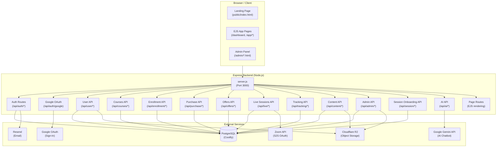
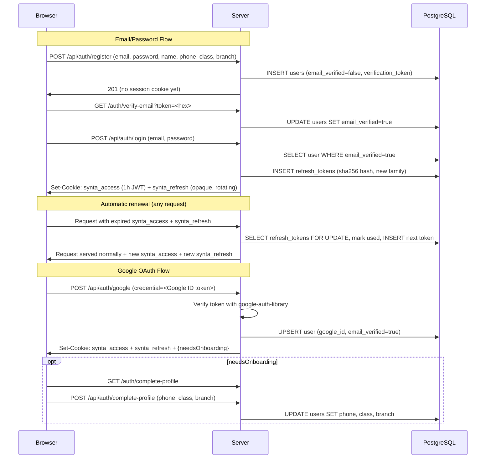

# ARCHITECTURE.md — Synta Academy

> **Last audited:** 2026-11-05  
> **Audited by:** Senior Software Architect (AI documentation audit)  
> **Status:** Reflects ACTUAL codebase — not aspirational

---

## 1. Project Overview

### Security remediation — 2026-11-10

Placement email proofs and verified placement cookies use a purpose-specific key derived from `JWT_SECRET`. The email proof binds a registration revision and expires after 30 minutes. An atomic revision update consumes it. Activation uses a transaction and row lock, creates only a new verified user and links the registration. The public registration response contains no registration credentials.

Wallet checkout is authoritative for paid courses. Offer checkout additionally writes an independent `payments` grant, linked to the wallet ledger by a server-generated `wallet-offer:<payment UUID>` transaction code. The user row lock serializes purchases; a partial unique index enforces one active grant per user/offer. Shared SQL authorization in `utils/offerAccess.js` enforces course expiry, offer rights, selected audiences and cancellation across student surfaces.

Recurring Zoom meetings use shared no-fixed-time IDs. Cancellation serializes on an advisory transaction lock for that meeting ID. A local occurrence can be cancelled while the meeting remains for other dates. Final-date or series cancellation confirms provider deletion before committing local cancelled status. An already-deleted Zoom meeting is safe to retry after an interrupted database commit.

Synta Academy is a **Tunisian e-learning platform** targeting high-school students (Bac Informatique, Bac Mathématiques, etc.) and their parents. It sells structured courses (video + PDF + quiz), bundled as "Offers", with live Zoom sessions for enrolled students. The platform is built in **French/Arabic** (UI multilingual) and uses **Tunisian Dinars (TND)** as currency.

**Core value propositions:**
- Self-paced course content (video, PDF, quizzes)
- Live Zoom sessions for enrolled students
- Internal wallet system for balance/purchases
- Admin-managed student enrollment and payment confirmation
- AI code debugger ("Bugi") for Bac Informatique students
- Pre-enrollment scoring session (placement quiz)

---

## 2. Technology Stack

### Backend
| Component | Technology | Version |
|-----------|-----------|---------|
| Runtime | Node.js | ≥18.x |
| Framework | Express.js | ^4.18.2 |
| Database ORM | Raw SQL via `pg` | ^8.23.0 |
| Authentication | JWT (jsonwebtoken) | ^9.0.3 |
| Password hashing | bcrypt | ^6.0.0 |
| Template engine | EJS | ^6.0.1 |
| Email | Resend | ^6.28.1 |
| AI integration | @google/genai (Gemini) | ^2.23.0 |
| Cookie handling | cookie-parser | ^1.4.7 |
| Security headers | Helmet | ^7.1.0 |
| CORS | cors | ^2.8.5 |
| OAuth | google-auth-library | ^11.1.0 |
| Object storage SDK | @aws-sdk/client-s3 | ^3.490.0 |
| Signed URLs | @aws-sdk/s3-request-presigner | ^3.490.0 |

### Database
| Component | Technology |
|-----------|-----------|
| Database | PostgreSQL (self-hosted via Coolify) |
| Client | `pg` (node-postgres) Pool |
| Migrations | Versioned SQL files in `/database/migrations/`, applied by the container before app start |

### Storage
| Component | Technology |
|-----------|-----------|
| Object storage | Cloudflare R2 (S3-compatible) |
| Access method | Pre-signed URLs (5-minute expiry default) |
| Content types | MP4 video, PDF, images (thumbnails, receipts) |
| Admin uploads | Short-lived signed R2 PUT URLs; lesson documents are stored in `lessons.pdf_key`, uploaded live replays reuse `live_sessions.replay_url` to store a private R2 object key |

### Frontend
| Component | Technology |
|-----------|-----------|
| Landing page | Static HTML (`backend/public/index.html`) |
| App pages | EJS templates (`backend/views/`) |
| Styling | Custom CSS (no framework) |
| Client JS | Vanilla JavaScript (no bundler/framework) |
| Admin panel | Static HTML + vanilla JS (`admin/`) |

### Student course visibility

The published course catalog and course-detail API filter offer-linked courses using the authenticated student's `users.class` and `users.branch`, and only consider active offers inside their validity window. A course linked to several offers appears when at least one active offer matches. A student with an active enrollment can continue to see that course even if targeting later changes. Published courses with no `offer_courses` association remain open in the catalog for public/free formations such as AI or web development. Course enrollment checks continue to govern actual lesson access.

### Interactive chapter quizzes

Lessons store an optional structured payload in `lessons.content` (JSONB). Interactive quizzes have exactly three questions and support `multiple_choice`, `true_false`, `code_drag_drop`, `ordering`, and `matching`. Admins create/edit them in the chapter manager and reorder them among lessons; students load payloads through the authenticated lesson-content endpoint and complete the quiz in the course page. Migration `202611050003_add_lesson_quiz_content.sql` adds the column.

### Lesson and live-session practice files

Admins can attach multiple common teaching resources to a lesson or live session in one multi-file selection: PDF and office documents, slides, spreadsheets, images, text/notes, programming source files, and ZIP archives. Uploads use short-lived R2 PUT URLs; `learning_resources` stores metadata and private object keys. Entitled students receive expiring signed links. Legacy single-PDF lesson attachments and new resources are displayed together in one compact lesson resource section; PDFs can be previewed or downloaded, and Python exercises can open in Code Pratique. Authenticated lesson and session Python-source endpoints read small .py objects server-side, so editor loading does not depend on browser-to-R2 CORS. Live-session resources appear in the replay player. Uploads remain limited to 25 MB per file and editor loading to 1 MB. Migration `202611050004_create_learning_resources.sql` creates the resource table.

### Infrastructure
| Component | Technology |
|-----------|-----------|
| Containerization | Docker (multi-stage, Node 20 Alpine) |
| Deployment | Coolify (self-hosted PaaS) |
| DNS/CDN | Cloudflare |
| Live sessions | Zoom (Server-to-Server OAuth) |
| Zoom token caching | In-memory (1-hour lifetime) |

---

## 3. High-Level System Architecture



---

## 4. Frontend Architecture

### Structure
The frontend is a **hybrid architecture** mixing static HTML and EJS templates:

```
backend/public/          ← Static assets served directly
  index.html             ← Landing/home page
  Accueil.html           ← Alternative landing (French)
  admin/                 ← Admin panel (static HTML + vanilla JS)
  js/                    ← Client-side JavaScript
  css/                   ← Stylesheets
  source/                ← Images, icons

backend/views/           ← EJS templates (server-rendered)
  pages/
    auth/                ← login, register, verify-email, complete-profile, password-reset
    dashboard/           ← Student dashboard
    courses/             ← Course list + details
    calendar/            ← Event calendar
    profile/             ← User profile
    wallet/              ← Balance / payment page
    offers/              ← Offer listing
    contact/             ← Contact form
    code/                ← Python code editor (Bugi AI)
    session/             ← Onboarding placement quiz
  partials/
    head.ejs             ← HTML head
    header.ejs           ← Navigation header
    sidebar.ejs          ← Sidebar
```

### Client-side JavaScript (vanilla)

The public homepage uses the existing WebP assets and content-hashed URLs. `utils/homepageDelivery.js` serves only root/index HTML, the landing stylesheet and its menu script with cached Brotli/gzip representations. It refreshes the homepage's versioned asset URLs from file contents on the first load after process startup. HTML uses conditional revalidation, while versioned public assets use immutable caching. Unversioned assets keep Express defaults. Range requests fall through to normal static serving, and private pages/APIs remain outside this delivery path.
Key files in `backend/public/js/`:
- `api-client.js` — Thin HTTP wrapper for all API calls
- `auth.js` / `authentication.js` — Login/register logic, session management
- `dashboard.js` — Dashboard data loading
- `courses.js` / `course-details.js` — Course browsing and lesson player
- `offers.js` — Offer listing and purchase
- `paiement.js` — Wallet top-up with receipt upload
- `profile.js` — Profile editing
- `calendar.js` — Event/live session calendar
- `chatbot.js` — Bugi AI code debugger UI
- `google-auth.js` — Google Sign-In integration
- `session.js` — Onboarding quiz flow
- `offers-config.js` — Static offer configuration data

### Student course navigation and player
Authenticated app navigation uses Turbo Drive from the shared head partial; the six student navigation destinations remain in the shared sidebar. Course detail data is fetched by `course-details.js`. Course structure and access checks run concurrently, followed by concurrent session, resource, and progress reads when the student has access. Lesson and replay media share the course main area. Lesson playback has chapter navigation; replay playback replaces that sidebar with the student's month-grouped replay list and switches recordings in place. Player controls return to the matching course panel. Lesson position is restored from the authenticated lesson-content response and saved periodically/on pause through `POST /api/tracking/position`; that endpoint checks preview/enrollment access and updates only `last_position`.

The app is server-rendered EJS with vanilla JavaScript; no client-side bundler or framework is used. Keep navigation and page behavior compatible with Turbo page visits and `turbo:load` lifecycles.

### Code Pratique Python runtimes
Code Pratique keeps Skulpt for short Python exercises without imports or `match/case`. Code containing imports or structural pattern matching is sent to a lazily created sandboxed iframe at `backend/public/pyodide-runner.html`, which loads pinned Pyodide 0.29.2 from jsDelivr. The runner uses `loadPackagesFromImports()` so packages such as NumPy are downloaded only when the student imports them. It returns console output, errors, and a simple variable snapshot to the EJS page. `input()` in this path uses the browser's native prompt; the existing Skulpt path keeps the custom input modal. The iframe has `allow-scripts allow-modals` sandbox permissions and does not receive same-origin access. Pyodide currently runs on the iframe's main thread, so long synchronous code can still affect responsiveness; a Worker solution must preserve interactive input before replacing this approach. While Web mode is deferred, the HTML/CSS/JavaScript mode selector and its “Aperçu” tab are hidden; the preview control should return only with Web mode.

### Admin Panel
Located at `admin/`. Entirely **static HTML + vanilla JS**, no server-side rendering. Authenticates by calling the same `/api/admin/*` endpoints as the backend. Main pages:
- `dashboard.html` / `overview.html` — Stats overview
- `students.html` — Student management
- `courses.html` — Course/module/lesson management
- `sessions.html` — Live session scheduling
- `offers.html` — Offer CRUD
- `free-session.html` — Placement quiz management

---

## 5. Backend Architecture

### Request Lifecycle
```
Request → CORS → Helmet → cookieParser → express.json → Logger
       → authApiRoutes → googleAuthRoutes → userApiRoutes
       → /api/content → /api/courses → /api/enrollment → /api/purchase
       → /api/offers → /api/live → /api/tracking → /api/ai
       → adminApiRoutes → /api/session
       → pageRoutes (EJS)
       → 404 handler → error handler
```

### Route Files
| Route file | Mount path | Auth required |
|------------|-----------|---------------|
| `auth-api.js` | `/api/auth/*` | Mixed (login/register = public) |
| `google-auth.js` | `/api/auth/google` | Public |
| `user-api.js` | `/api/user/*`, `/api/events` | Required |
| `content.js` | `/api/content/*` | Required |
| `courses.js` | `/api/courses/*` | Mixed |
| `enrollment.js` | `/api/enrollment/*` | Mixed |
| `purchase.js` | `/api/purchase/*` | `authApiMiddleware` (JWT cookie) |
| `offers.js` | `/api/offers/*` | Optional |
| `live.js` | `/api/live/*` | Mixed |
| `tracking.js` | `/api/tracking/*` | Required |
| `admin-api.js` | `/api/admin/*` | Admin only |
| `session.js` | `/api/session/*` | Mixed |
| `ai-api.js` | `/api/ai/*` | Mixed (`/debug` requires `authApiMiddleware`; model diagnostic remains public) |
| `pages.js` | Various HTML routes | Mixed |

### Middleware Stack
| Middleware | Purpose |
|-----------|---------|
| `requireAuth` | Redirects unauthenticated page requests to `/login?next=<page>` (`utils/returnPath.js` validates destinations; `&reason=expired` when a session existed) |
| `authApiMiddleware` | Returns 401 JSON for unauthenticated API requests |
| `authMiddleware` | Optional auth — sets `req.user` or null |
| `requireAdmin` | Checks JWT role=admin or ADMIN_EMAILS list |
| `attachUserProfile` | Fetches DB user profile, attaches to `req.userProfile` |
| `checkLessonAccess` | Checks enrollment for lesson content access |

Client side, `head.ejs` loads `public/js/session-guard.js` on signed-in app pages, together with a `synta-session-expires-in` meta tag (seconds left on the access token). The guard wraps `fetch`:
- A same-origin `/api/*` 401 (excluding `/api/auth/*`) opens the session-expired dialog.
- Failed `/api/tracking/progress` and `/api/tracking/response` saves are kept in `sessionStorage` and replayed after re-login.
- A banner warns the student 5 minutes before expiry.

It does not renew sessions; renewal is roadmap P0-4.

---

## 6. Database Architecture

**Database:** PostgreSQL (self-hosted via Coolify Docker)  
**Connection:** Single `pg.Pool` instance (10 max connections, 30s idle timeout)  
**SSL:** Disabled for same-server Docker networking, configurable via `DB_SSL=true`

Schema is defined in `/database/schema_postgres.sql` and supplemented by incremental migration files in `/database/`.

**Notable design choices:**
- No ORM — all queries are raw SQL with parameterized inputs
- Deploy migrations are numbered SQL files in `database/migrations/`; the container runner applies new files transactionally before starting Express
- Some columns are added at runtime via `ALTER TABLE ... ADD COLUMN IF NOT EXISTS` in route files (anti-pattern)
- Existing runtime `ALTER TABLE` calls in route files remain and are tracked in TASK-004; notifications table creation has moved to a deployment migration

---

## 7. Authentication Architecture



**Token mechanics:**
- Access token: 1-hour JWT (payload: id, email, name, role)
- Refresh token: opaque 32-byte random value; only its SHA-256 hash is stored in `refresh_tokens`. All sign-in paths (password, Google popup and iPhone callback, placement `/set-password`) call `startSession()` in `services/sessions.js`.
- Both cookies are HttpOnly, `Secure` in production and `SameSite=Lax` (links from WhatsApp or email keep the student signed in; cross-site POSTs carry no cookie).
- Renewal: `sessionRenewal(pool)` from `middleware/requireAuth.js` is mounted in `server.js` before all routes. When the access token is missing or expired and a refresh cookie is present (outside `/api/auth/*`), it rotates the token in a transaction and continues the request with the new access token, so `requireAuth`, `authApiMiddleware`, `requireAdmin` and `auth.js` need no changes.
- Rotation rules: each refresh token works once; a token reused within 20 seconds (parallel tabs) gets an access token only; a reuse after that revokes the whole family. Idle limit 7 days, absolute cap 30 days after sign-in. Logout revokes the family. Failed renewals are throttled per IP (30 per 15 minutes).
- Pre-2B refresh JWTs (`type="refresh"`) are accepted once, recorded as used, and converted into a new family.
- Fail-safe: if the database or table is unavailable, renewal is skipped without clearing the refresh cookie (the student sees the normal login redirect or 401), and sign-in falls back to a plain one-hour session.
- Magic login: Admin can generate a 5-minute JWT to log in as any user (no audit log). These sessions are not renewable: no refresh token is issued and the admin's own refresh family in that browser is revoked. Only non-renewable sessions get the `synta-session-expires-in` warning meta.

---

## 8. Authorization Architecture

| Role | Value in DB | Access |
|------|------------|--------|
| Student | `user` | Own data, enrolled content |
| Admin | `admin` | All admin endpoints, all student data |

**Admin detection (dual mechanism — potential confusion):**
1. `role = 'admin'` in JWT payload (set at login from DB)
2. Email in `ADMIN_EMAILS` environment variable

Both mechanisms work in `requireAdmin.js`. This can lead to situations where a user promoted via email env var cannot access admin features after re-login if their DB role is still `user`.

**Content access control:**
- Lesson content requires enrollment in the parent course OR `is_preview = true`
- Access checked in `checkLessonAccess()` via SQL join through modules → enrollments
- Enrollment expiry is checked (`expires_at IS NULL OR expires_at > NOW()`)

---

## 9. API Communication

### Protocol
- REST API over HTTP/HTTPS
- JSON request/response bodies
- Cookie-based authentication (HttpOnly)
- CORS configured via `ALLOWED_ORIGINS` env var

### Key API Groups
```
/api/auth/*          Authentication (register, login, logout, verify-email, google)
/api/user/*          User profile, stats, balance, activity, transactions, notifications
/api/courses/*       Course catalog, enrollment status, progress
/api/content/*       Lesson content (signed URLs), progress updates, thumbnails
/api/enrollment/*    Enroll in course/offer, list enrollments
/api/purchase/*      Balance-based course/offer purchase
/api/offers/*        Offer catalog with per-user targeting
/api/live/*          Course sessions/replays, upcoming sessions, join check (/:id/join), admin scheduling, replay links and Zoom recording review
/api/zoom/webhook    Zoom event receiver (signature-verified; raw body, mounted before express.json)
/api/tracking/*      Quiz responses, weak topics, lesson progress, feedback
/api/admin/*         Student management, payment confirmation, course/offer admin, notifications
/api/session/*       Placement quiz flow (register, questions, submit, set-password)
/api/ai/debug        Gemini-powered tutor; stores successful exchanges
/api/ai/history      Signed-in student transcript pagination and deletion (GET/DELETE)
/api/events          Calendar events (static + live sessions)
/health              Health check
```
### Bugi learning intelligence

The signed-in debug handler fetches academic context, the latest exchange for follow-up questions, and up to 300 learning observations from the previous 180 days in parallel. `backend/services/bugi-learning.js` normalizes the Python taxonomy, derives the account's learning profile from distinct observations, and selects relevant observations and explicit preferences. The prompt uses a conservative UTF-8 byte cap as a token-budget proxy. `BUGI_LEARNING_CONTEXT_TOKENS` is optional (64–1200, default 720).

Gemini can append structured metadata to its normal reply. The backend strips it before saving the transcript and validates signal kinds, concept keys and excerpts from the current student input. It stores only canonical keys and fingerprints, linked to the tutor reply. A learning write failure does not fail the reply. History deletion advances the account revision and cascades to evidence in the same transaction. Reply persistence locks the account row and checks the captured revision before writing the transcript and evidence. The Gemini call runs outside the transaction. A stale reply retains the HTTP success response shape with an empty saved array. Raw attachments and excerpts are never written into evidence records.

Future quiz selection can call `getBugiLearningProfile(pool, verifiedStudentId)` and `getBugiPracticeRecommendations(profile)` from the backend. No quiz endpoint is exposed.
The internal on-demand deep analysis entry point is `analyzeStudentLearning(pool, verifiedStudentId)` in `backend/services/learning-intelligence.js`. It sends a bounded summary of supported difficulties, progress and explicit preferences, without IDs, transcripts or code. It uses only `LEARNING_GEMINI_API_KEY`, rejects reuse of the chat key, and pauses independently on a provider quota error. Use a separate Gemini project for a separate quota. Set `LEARNING_GEMINI_ENABLED=false` to disable it. The normal chat path continues to use `GEMINI_API_KEY` and never invokes deep analysis.

---

## 10. External Integrations

### Cloudflare R2 (Object Storage)

The admin course editor can select an associated offer image, list recent raster images under the existing `Courses-th/` prefix, or upload a raster image there (up to 5 MiB). It stores the selected reference in `courses.thumbnail_url`. The session-protected `/api/content/course-image/:key` route signs only keys in that image folder. Removing a course thumbnail clears the reference on save and preserves shared R2 objects.
- Used for: course videos, PDFs, thumbnails, payment receipts
- Access: Private bucket with signed URLs (5-minute default expiry)
- SDK: AWS SDK v3 (S3-compatible)
- Upload: Backend only (admin adds content)
- Receipts upload: Students upload base64 → server uploads to R2

### Zoom (Live Sessions)
- Authentication: Server-to-Server OAuth (account-level, no user auth)
- Token caching: In-memory, refreshed 60 seconds before 1-hour expiry
- Operations: Create meeting, delete meeting
- Security: `zoom_start_url` (host link) stored in DB but **never sent to students**. Students don't receive `zoom_join_url` either: they get `/api/live/:id/join`, which re-checks access and the join window (10 minutes before the start until the scheduled end) and then redirects.
- Access rule: one SQL fragment, `liveSessionAccess` in `utils/offerAccess.js`, is shared by every student endpoint (upcoming, course sessions, replays, calendar events, join, resources). `services/live-features.js` detects at startup whether held migration `202611200002` is applied; until it is, the SQL is identical to the previous rule.
- Replay: `replay_url` can be set manually, or automatically by the Zoom → R2 import:
  - `POST /api/zoom/webhook` (`routes/zoom-webhook.js`) verifies the `x-zm-signature` HMAC with `ZOOM_WEBHOOK_SECRET_TOKEN` and a 5-minute timestamp window. It answers `endpoint.url_validation` and queues one `zoom_recording_imports` row per MP4 segment, deduplicated by Zoom file ID. Meetings unknown to Synta are ignored.
  - `services/zoom-recordings.js` holds the logic. `services/recording-worker.js` runs it in-process on a 30-second timer, plus an immediate kick after each webhook.
  - The worker claims a job with `FOR UPDATE SKIP LOCKED` and a 15-minute lease, renewed on every part. It streams the MP4 from Zoom (bearer token, which is never forwarded to the storage redirect) into an R2 multipart upload in 16 MiB parts, so memory stays flat. It then verifies the size with a HEAD request.
  - Retries come after 1 m, 5 m, 30 m, 2 h and 6 h, with 6 tries maximum. Unfinished multipart uploads are aborted on failure and when a stale job is reclaimed after a restart.
  - A single segment for a matched occurrence (closest `scheduled_at`) is published only into an empty `replay_url`. Every other case waits for the admin in `sessions.html`. Zoom recordings are never deleted.
  - Enabled only when the table exists and `ZOOM_RECORDING_IMPORT_ENABLED=true`; otherwise the webhook answers 503 so Zoom retries later.
  - R2 helpers: `createR2MultipartUpload`, `uploadR2Part`, `completeR2MultipartUpload`, `abortR2MultipartUpload` in `utils/r2Utils.js`. Zoom download: `openZoomRecordingDownload` in `utils/zoomClient.js` (https `zoom.us` hosts only).
  - Playback reuses the one-hour signed R2 GET URLs, with native Range support. The course player fetches a fresh link once per minute per session when a signed link expires.

### Google Gemini API (AI)
- Used for: "Bugi" code debugger (Python code analysis)
- Models: Fallback chain — `gemini-3.6-flash` → `gemini-3.5-flash-lite` → `gemini-3.5-flash`
- Language: Responds in Tunisian Darja (Arabic script)
- No authentication required on the endpoint (⚠️ open to abuse)

### Resend (Email)
- Used for: Email verification links
- From address: `contact@syntaacademy.tn`
- Template: Arabic RTL HTML email
- Domain: `syntaacademy.tn`

### Google OAuth
- Used for: Google Sign-In on login/register pages
- Library: `google-auth-library` (server-side token verification)
- Flow: Google-rendered button on login and registration, with a same-origin JSON popup callback or iOS form redirect. The redirect validates Google's CSRF cookie and form field before verifying the ID token. The browser and verifier share Coolify's `GOOGLE_CLIENT_ID`.

---

## 11. File Storage Architecture

```
Cloudflare R2 Bucket
├── courses/
│   └── {courseId}/
│       └── {moduleId}/
│           └── {lessonId}/
│               ├── video.mp4        (video_key in lessons table)
│               └── notes.pdf        (pdf_key in lessons table)
├── thumbnails/
│   └── {filename}.webp              (thumbnail_key in courses table)
└── receipts/
    └── {userId}-{timestamp}.{ext}   (receipt_url in transactions table)
```

**Access pattern:** Server generates signed URL → returns to client → client fetches directly from R2.  
**Signed URL expiry:** 300s (5 min) for content, 3600s (1 hr) for thumbnails.

---

## 12. Known Architectural Problems

### 🔴 Critical
1. **Schema migrations via runtime ALTER TABLE** — Several routes run `ALTER TABLE ... ADD COLUMN IF NOT EXISTS` on each startup. This is fragile, unversioned, and masks schema drift.
2. ~~**No refresh token redemption**~~ — Resolved 2026-11-20 (Batch 2B): rotating refresh tokens renew sessions automatically. Renewal needs `database/pending-migrations/202611200001_create_refresh_tokens.sql`. The file is held outside `database/migrations/` so the Docker runner cannot apply it; until the owner approves and moves it, sessions last one hour as before.
3. **Magic login has no audit log** — Admin can impersonate any user with no trace.

### 🟡 High
4. **Duplicate middleware for auth** — Two separate auth systems (`authMiddleware` in `auth.js` using Bearer + Cookie, `authApiMiddleware` in `requireAuth.js` using Cookie only). Inconsistently applied.
5. **Session audiences** — `live_sessions` link to courses and can include a list of eligible student IDs. The live API and student calendar enforce this audience alongside active course and optional offer enrollment. Reusable group memberships remain part of TASK-013.
6. **No versioned migration system** — SQL files in `/database/` are not tracked, ordered, or reversible.
7. **Admin panel is unauthenticated on first load** — The admin HTML files are served as static files with no server-side auth check. Auth is enforced only via API calls.
8. **`purchases` table is partially duplicated** — Both `purchases` and `transactions` track financial operations inconsistently.

### 🟠 Medium
9. **No rate limiting** — No protection against brute-force on `/api/auth/login` or `/api/ai/debug`.
10. **No input sanitization library** — Relies on parameterized queries (safe for SQL injection) but no XSS/validation library.
11. **Static events file** — `/api/events` loads from `backend/public/data/events.js` as static JS. No DB-backed event management.
14. **`password_hash` can be NULL** — Google users have `NULL` password, schema allows it, but login route doesn't handle this cleanly.

---

## 13. Recommended Future Improvements

| Priority | Improvement |
|----------|------------|
| ~~CRITICAL~~ | ~~Implement refresh token redemption flow~~ — done 2026-11-20 (Batch 2B) |
| HIGH | Migrate to versioned migrations (Knex migrations or plain numbered SQL files) |
| HIGH | Add `groups` and `group_memberships` tables for cohort management |
| HIGH | Add rate limiting (express-rate-limit) |
| HIGH | Audit and unify the dual middleware systems |
| HIGH | Add audit log for admin impersonation (magic login) |
| MEDIUM | Add a `formations` layer (a bundle of related courses) |
| MEDIUM | Implement attendance tracking for live sessions |
| MEDIUM | Add webhook handling for Zoom cloud recordings → auto-set `replay_url` |
| MEDIUM | Move static events to a database table |
| LOW | Add Stripe or Flouci payment gateway integration |
| LOW | Add TypeScript for type safety |
| LOW | Add automated tests (Jest + supertest) |


## Timed offer architecture

The timed router runs before the legacy purchase router and forwards legacy request bodies. The backend revalidates signed quotes under database locks and writes grants, payments and wallet changes in one transaction. Course authorization checks active grant snapshots and legacy enrollment rights independently. A guarded reminder worker inserts notifications with database deduplication. The calendar suggestion route uses only the dedicated Learning Gemini credential and stores admin-review drafts. See [the technical plan](OFFER_ACCESS_TECHNICAL_PLAN.md) for routes and rollout.

### Timed-offer reconciliation

The admin overview separates confirmed deposit transactions, purchase transactions net of installment reversals, and remaining confirmed installment balances. The historical purchases register is displayed separately because historical rows may lack a verified ledger mapping. Existing R2 links remain bearer URLs until their signed expiry. Protected application requests recheck authorization. Joined Zoom meetings and external media follow provider behavior.

### Offer upgrade credit

The existing timed-offer router serves signed upgrade quotes, atomic confirmations, admin policy and correction operations, and wallet collection of the next scheduled tranche. The shared student row lock serializes source collection, reversal and credit use. Unique payment claims and grant-origin constraints provide database enforcement. The original legacy path remains available for unconfigured offers. The new sales paths require both TIMED_OFFER_SALES_ENABLED and TIMED_OFFER_UPGRADES_ENABLED.
