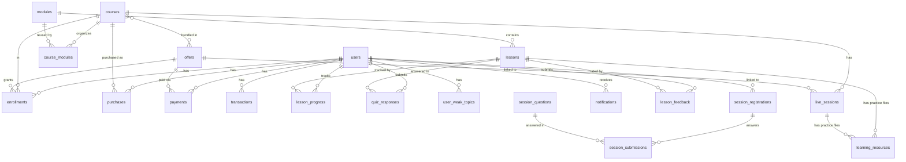

# DATABASE_SCHEMA.md — Synta Academy

> **Last audited:** 2026-11-05  
> **Source of truth:** `database/schema_postgres.sql` + versioned files in `database/migrations/`
> **Active database:** PostgreSQL (self-hosted via Coolify)

> [!IMPORTANT]
> This document describes the schema as defined in migration files. The **actual live database state may differ** because some columns are added at runtime via `ALTER TABLE ... ADD COLUMN IF NOT EXISTS` in route files. Always verify against the live DB before making schema changes.

---

## 1. Schema Overview



---

## 2. Tables — Detailed Reference

### 2.1 `users`

**Purpose:** Central identity table. Stores all user accounts (students and admins).

| Column | Type | Constraints | Notes |
|--------|------|-------------|-------|
| `id` | UUID | PK, DEFAULT gen_random_uuid() | |
| `email` | TEXT | UNIQUE NOT NULL | Lowercased on insert |
| `password_hash` | TEXT | NULLABLE | NULL for Google-only accounts |
| `name` | TEXT | NOT NULL | Display name |
| `phone` | TEXT | NULLABLE | Tunisian phone number |
| `role` | TEXT | NOT NULL DEFAULT 'user' | `'user'` or `'admin'` |
| `balance` | NUMERIC(10,2) | NOT NULL DEFAULT 0 | Internal wallet balance (TND) |
| `class` | TEXT | NULLABLE | Academic level: `1ere`, `2eme`, `3eme`, `bac`, `other` |
| `branch` | TEXT | NULLABLE | Academic branch: `informatique`, `mathematiques`, `sciences`, `technique`, `lettres`, `economie`, `other` |
| `created_at` | TIMESTAMPTZ | NOT NULL DEFAULT NOW() | |

| `updated_at` | TIMESTAMPTZ | NOT NULL DEFAULT NOW() | |
| `google_id` | TEXT | UNIQUE, NULLABLE | Added by `add_google_auth.sql` |
| `email_verified` | BOOLEAN | NOT NULL DEFAULT false | Added by `add_email_verification.sql` |
| `verification_token` | TEXT | NULLABLE | 64-char hex, 24h expiry |
| `token_expires_at` | TIMESTAMPTZ | NULLABLE | Expiry for verification token |
| `debt` | NUMERIC(10,2) | DEFAULT 0, NULLABLE | Added at runtime in `admin-api.js` via ALTER TABLE |

**Indexes:**
- `idx_users_google_id` on `google_id` WHERE NOT NULL
- `idx_users_verification_token` on `verification_token` WHERE NOT NULL
- `idx_users_role` on `role` (from `add_admin_role.sql`, references old `public."Users"` table — may not be active)

> [!WARNING]
> The `debt` column is added at runtime by `ensureUsersSchema()` in `admin-api.js`, not in the base schema. This is an anti-pattern — the column may not exist until the first admin API call.

---

### 2.2 `courses`

**Purpose:** Learning content catalog. Each course contains modules → lessons.

| Column | Type | Constraints | Notes |
|--------|------|-------------|-------|
| `id` | UUID | PK, DEFAULT gen_random_uuid() | |
| `title` | TEXT | NOT NULL | |
| `description` | TEXT | NULLABLE | |
| `category` | TEXT | NULLABLE | e.g., `bac-info`, `bac-math`, `web-dev` |
| `level` | TEXT | NULLABLE | `beginner`, `intermediate`, `advanced` |
| `price` | NUMERIC(10,2) | NOT NULL DEFAULT 0 | Individual course price (TND) |
| `is_free` | BOOLEAN | NOT NULL DEFAULT false | Marks free courses |
| `is_published` | BOOLEAN | NOT NULL DEFAULT false | Public visibility |
| `thumbnail_url` | TEXT | NULLABLE | Full URL or R2 key |
| `thumbnail_key` | TEXT | NULLABLE | R2 object key for thumbnail |
| `created_at` | TIMESTAMPTZ | NOT NULL DEFAULT NOW() | |
| `updated_at` | TIMESTAMPTZ | NOT NULL DEFAULT NOW() | |

> [!NOTE]
> `thumbnail_url` and `thumbnail_key` overlap — some older code stores full URLs, newer code stores R2 keys. Both fields exist to handle the transition.

---

### 2.3 `modules`

**Purpose:** Reusable educational chapters (for example, Variables or Arrays). Lessons belong to a module; course placement and ordering are represented by `course_modules`.

| Column | Type | Constraints | Notes |
|--------|------|-------------|-------|
| `id` | UUID | PK, DEFAULT gen_random_uuid() | |
| `course_id` | UUID | NOT NULL REFERENCES courses(id) ON DELETE CASCADE | Legacy single-course link, retained during transition |
| `title` | TEXT | NOT NULL | |
| `description` | TEXT | NULLABLE | |
| `order_index` | INTEGER | NOT NULL DEFAULT 0 | Legacy order, copied to `course_modules` during migration |
| `created_at` | TIMESTAMPTZ | NOT NULL DEFAULT NOW() | |

---

### 2.3a `course_modules` (new)

**Purpose:** Maps reusable modules into one or more courses, with a separate display order per course. Migration `202611050002_create_course_modules.sql` backfills the existing `modules.course_id/order_index` values. Legacy columns remain for compatibility and are not authoritative for new course lookups.

| Column | Type | Constraints | Notes |
|--------|------|-------------|-------|
| `course_id` | UUID | NOT NULL REFERENCES courses(id) ON DELETE CASCADE | Course using the module |
| `module_id` | UUID | NOT NULL REFERENCES modules(id) ON DELETE CASCADE | Shared educational module |
| `order_index` | INTEGER | NOT NULL DEFAULT 0 | Position within this course |
| `created_at` | TIMESTAMPTZ | NOT NULL DEFAULT NOW() | |
| PRIMARY KEY | | (`course_id`, `module_id`) | Prevents duplicate placement |

Indexes: `idx_course_modules_module`; `idx_course_modules_course_order`.

### `schema_migrations`

Created automatically by the deployment runner. Tracks each applied migration filename and SHA-256 checksum; do not edit a migration after it has been applied.

---

### 2.4 `lessons`

**Purpose:** Individual learning units within a module. Supports video, PDF, and quiz types.

| Column | Type | Constraints | Notes |
|--------|------|-------------|-------|
| `id` | UUID | PK, DEFAULT gen_random_uuid() | |
| `module_id` | UUID | NOT NULL REFERENCES modules(id) ON DELETE CASCADE | |
| `title` | TEXT | NOT NULL | |
| `description` | TEXT | NULLABLE | |
| `type` | TEXT | NULLABLE | `'video'`, `'pdf'`, `'quiz'` |
| `content` | JSONB | NOT NULL DEFAULT `{}` | Added by `202611050003_add_lesson_quiz_content.sql`; interactive quiz payload `{version: 1, questions: [...]}` |
| `video_key` | TEXT | NULLABLE | R2 object key OR full URL |
| `pdf_key` | TEXT | NULLABLE | R2 object key OR full URL |
| `duration` | INTEGER | NULLABLE | Video duration in seconds |
| `order_index` | INTEGER | NOT NULL DEFAULT 0 | Display order |
| `is_preview` | BOOLEAN | NOT NULL DEFAULT false | Free preview — bypasses enrollment check |
| `created_at` | TIMESTAMPTZ | NOT NULL DEFAULT NOW() | |

Admin lesson PDF/Word uploads use `pdf_key` for the private R2 object key. The student course-resource endpoint returns short-lived signed download URLs only after checking course enrollment.

### 2.4a `learning_resources`

**Purpose:** Multiple private practice-file attachments for a lesson or live session. Files live in R2; the database stores metadata and the object key. Migration: `202611050004_create_learning_resources.sql`.

| Column | Type | Constraints | Notes |
|--------|------|-------------|-------|
| `id` | UUID | PK, DEFAULT gen_random_uuid() | |
| `lesson_id` | UUID | NULLABLE REFERENCES lessons(id) ON DELETE CASCADE | Exactly one of lesson/session owner is set |
| `live_session_id` | UUID | NULLABLE REFERENCES live_sessions(id) ON DELETE CASCADE | Exactly one of lesson/session owner is set |
| `title` | TEXT | NOT NULL | Display name |
| `file_name` | TEXT | NOT NULL | Original download name |
| `object_key` | TEXT | NOT NULL UNIQUE | Private R2 object key |
| `content_type` | TEXT | NOT NULL | Validated source/archive MIME type |
| `file_size` | BIGINT | NOT NULL CHECK > 0 | Maximum 25 MB per file enforced by API |
| `created_at` | TIMESTAMPTZ | NOT NULL DEFAULT NOW() | |

Check constraint `learning_resources_single_owner` ensures exactly one parent. Indexes: `idx_learning_resources_lesson`, `idx_learning_resources_live_session`.

---

### 2.5 `offers`

**Purpose:** Bundled pricing packages. An offer contains multiple courses at a fixed price. Supports targeted delivery by student class/branch.

| Column | Type | Constraints | Notes |
|--------|------|-------------|-------|
| `id` | UUID | PK, DEFAULT gen_random_uuid() | |
| `title` | TEXT | NOT NULL | |
| `description` | TEXT | NULLABLE | |
| `fixed_price` | NUMERIC(10,2) | NULLABLE | Total price of the offer bundle |
| `price` | NUMERIC(10,2) | NULLABLE | Alias/legacy price field |
| `discount_percentage` | NUMERIC(5,2) | NULLABLE | Added by `admin-api.js` ensureOffersSchema() |
| `is_active` | BOOLEAN | NOT NULL DEFAULT true | |
| `valid_from` | TIMESTAMPTZ | NULLABLE | Offer availability start |
| `valid_until` | TIMESTAMPTZ | NULLABLE | Offer expiry |
| `target_classes` | TEXT[] | DEFAULT '{}' | Added by `add_offers_targeting.sql` |
| `target_branches` | TEXT[] | DEFAULT '{}' | Added by `add_offers_targeting.sql` |
| `features` | JSONB | DEFAULT '[]' | Added by `add_offers_features.sql` — e.g., `{live_access, exams, community}` |
| `is_best_seller` | BOOLEAN | DEFAULT false | Added at runtime in `admin-api.js` |
| `image_url` | TEXT | NULLABLE | Added at runtime in `admin-api.js` |
| `created_at` | TIMESTAMPTZ | NOT NULL DEFAULT NOW() | |

> [!WARNING]
> `discount_percentage`, `is_best_seller`, and `image_url` are added via `ensureOffersSchema()` at runtime in `admin-api.js`, not in the base schema file.

---

Offers can advertise Bugi tutoring with an active feature entry such as `{"key":"bugi","text":"Tutorat Bugi","active":true}`.

**Proposed, pending confirmation:** Add `users.bugi_free_replies_used` as a non-null integer defaulting to zero, constrained to 0–5. Reserve one slot atomically before a free Gemini reply and return the slot if generation fails. Check active Bugi offer entitlements before using a free slot.

### 2.6 `offer_courses`

**Purpose:** Many-to-many join between offers and courses.

| Column | Type | Constraints |
|--------|------|-------------|
| `offer_id` | UUID | REFERENCES offers(id) ON DELETE CASCADE |
| `course_id` | UUID | REFERENCES courses(id) ON DELETE CASCADE |
| PRIMARY KEY | | (offer_id, course_id) |

---

### 2.7 `enrollments`

**Purpose:** Records student access to courses. Created when a purchase completes or admin manually enrolls.

| Column | Type | Constraints | Notes |
|--------|------|-------------|-------|
| `id` | UUID | PK, DEFAULT gen_random_uuid() | |
| `user_id` | UUID | NOT NULL REFERENCES users(id) ON DELETE CASCADE | |
| `course_id` | UUID | NOT NULL REFERENCES courses(id) ON DELETE CASCADE | |
| `offer_id` | UUID | NULLABLE REFERENCES offers(id) | Which offer triggered this enrollment |
| `payment_id` | TEXT | NULLABLE | External payment reference |
| `amount_paid` | NUMERIC(10,2) | NOT NULL DEFAULT 0 | Amount paid for this course slot |
| `progress` | NUMERIC(5,2) | NOT NULL DEFAULT 0 | Course completion % (0-100) |
| `completed` | BOOLEAN | NOT NULL DEFAULT false | 100% = completed |
| `completed_lessons` | INTEGER | NOT NULL DEFAULT 0 | Count of completed lessons |
| `enrolled_at` | TIMESTAMPTZ | NOT NULL DEFAULT NOW() | |
| `last_accessed` | TIMESTAMPTZ | NULLABLE | Last lesson access timestamp |
| `expires_at` | TIMESTAMPTZ | NULLABLE | NULL = lifetime access |
| UNIQUE | | (user_id, course_id) | One enrollment per user per course |

**Indexes:** `idx_enrollments_user`, `idx_enrollments_course`

---

### 2.8 `purchases`

**Purpose:** Transaction record for individual course purchases. **Partially overlaps with `transactions`.**

| Column | Type | Constraints | Notes |
|--------|------|-------------|-------|
| `id` | UUID | PK, DEFAULT gen_random_uuid() | |
| `user_id` | UUID | NOT NULL REFERENCES users(id) ON DELETE CASCADE | |
| `course_id` | UUID | NULLABLE REFERENCES courses(id) | |
| `amount` | NUMERIC(10,2) | NOT NULL | |
| `payment_status` | TEXT | NOT NULL DEFAULT 'pending' | `pending`, `completed`, `failed`, `refunded` |
| `transaction_id` | TEXT | NULLABLE | External reference |
| `purchased_at` | TIMESTAMPTZ | NOT NULL DEFAULT NOW() | |
| `confirmed_at` | TIMESTAMPTZ | NULLABLE | |

> [!WARNING]
> The `purchases` table is used by some routes but is **not the primary financial ledger**. The `transactions` table is used by the wallet/payment system. There is duplication and inconsistency.

---

### 2.9 `payments`

**Purpose:** Offer payment and authorization record. Wallet checkout writes `wallet_completed`; authorized admin installment enrollment writes `admin_authorized`. These records grant offer benefits independently of the single enrollment per user/course.

| Column | Type | Constraints | Notes |
|--------|------|-------------|-------|
| `id` | UUID | PK, DEFAULT gen_random_uuid() | |
| `user_id` | UUID | NOT NULL REFERENCES users(id) ON DELETE CASCADE | |
| `offer_id` | UUID | NULLABLE REFERENCES offers(id) | |
| `amount` | NUMERIC(10,2) | NOT NULL | |
| `status` | TEXT | NOT NULL DEFAULT 'pending' | Active grants use `wallet_completed` or `admin_authorized`. `refunded`, `cancelled`, `canceled` and `expired` revoke legacy offer fallback. |
| `created_at` | TIMESTAMPTZ | NOT NULL DEFAULT NOW() | |

Migration `202611100003_unique_active_offer_payments.sql` adds a partial unique index on `(user_id, offer_id)` for the two active grant statuses. Historical rows are preserved. These dedicated statuses avoid reinterpreting unverified legacy payment rows as paid access. Currency remains the platform's fixed TND.

---

### 2.10 `transactions`

**Purpose:** Internal wallet ledger. Records all balance changes (deposits, purchases, refunds).

| Column | Type | Constraints | Notes |
|--------|------|-------------|-------|
| `id` | UUID | PK, DEFAULT gen_random_uuid() | |
| `user_id` | UUID | NOT NULL REFERENCES users(id) ON DELETE CASCADE | |
| `amount` | NUMERIC(10,2) | NOT NULL | |
| `type` | TEXT | NOT NULL | `'deposit'`, `'purchase'`, `'refund'`, `'withdrawal'` |
| `status` | TEXT | NOT NULL DEFAULT 'pending' | `'pending'`, `'completed'`, `'rejected'` |
| `payment_method` | TEXT | NULLABLE | e.g., `'CIB'`, `'D17'`, bank transfer name |
| `transaction_code` | TEXT | NULLABLE | Auto-generated `TXN-{timestamp}` or user-provided |
| `description` | TEXT | NULLABLE | Human-readable description |
| `is_confirmed` | BOOLEAN | NOT NULL DEFAULT false | Whether admin confirmed it |
| `processed_at` | TIMESTAMPTZ | NULLABLE | When admin confirmed/rejected |
| `receipt_url` | TEXT | NULLABLE | URL to payment proof image in R2 |
| `created_at` | TIMESTAMPTZ | NOT NULL DEFAULT NOW() | |

**Index:** `idx_transactions_user`

> [!NOTE]
> The status `'approved'` and `'cancelled'` appear in some admin queries as aliases for `'completed'` and `'rejected'`. The schema defines `'completed'` and `'rejected'` as canonical values.

---

### 2.11 `lesson_progress`

**Purpose:** Tracks individual student progress on each lesson.

| Column | Type | Constraints | Notes |
|--------|------|-------------|-------|
| `id` | UUID | PK, DEFAULT gen_random_uuid() | |
| `user_id` | UUID | NOT NULL REFERENCES users(id) ON DELETE CASCADE | |
| `lesson_id` | UUID | NOT NULL REFERENCES lessons(id) ON DELETE CASCADE | |
| `completed` | BOOLEAN | NOT NULL DEFAULT false | |
| `progress_percentage` | NUMERIC(5,2) | NOT NULL DEFAULT 0 | 0-100 |
| `last_position` | INTEGER | NOT NULL DEFAULT 0 | Video resume position in seconds |
| `completed_at` | TIMESTAMPTZ | NULLABLE | Timestamp when lesson was completed |
| `updated_at` | TIMESTAMPTZ | NOT NULL DEFAULT NOW() | |
| UNIQUE | | (user_id, lesson_id) | |

**Indexes:** `idx_lesson_progress_user`

---

### 2.12 `live_sessions`

**Purpose:** Scheduled Zoom sessions linked to a course (and optionally an offer).

| Column | Type | Constraints | Notes |
|--------|------|-------------|-------|
| `id` | UUID | PK, DEFAULT gen_random_uuid() | |
| `course_id` | UUID | NOT NULL REFERENCES courses(id) ON DELETE CASCADE | |
| `offer_id` | UUID | NULLABLE REFERENCES offers(id) | If set, only offer enrollees see this session |
| `audience_student_ids` | UUID[] | NULLABLE, nonempty when set | Further restricts access to the selected students with eligible enrollments |
| `title` | TEXT | NOT NULL | |
| `description` | TEXT | NULLABLE | |
| `scheduled_at` | TIMESTAMPTZ | NOT NULL | |
| `duration_minutes` | INTEGER | NOT NULL DEFAULT 60 | |
| `status` | TEXT | NOT NULL DEFAULT 'scheduled' | `'scheduled'`, `'live'`, `'completed'`, `'cancelled'` |
| `zoom_meeting_id` | TEXT | NULLABLE | Zoom meeting ID |
| `zoom_join_url` | TEXT | NULLABLE | Student join link |
| `zoom_start_url` | TEXT | NULLABLE | 🔒 Host-only link — NEVER expose to students |
| `zoom_password` | TEXT | NULLABLE | |
| `replay_url` | TEXT | NULLABLE | External HTTPS URL or private R2 object key uploaded by an admin; students receive a short-lived signed URL |
| `created_at` | TIMESTAMPTZ | NOT NULL DEFAULT NOW() | |

**Indexes:** `idx_live_sessions_course`, `idx_live_sessions_scheduled`

Migration `202611100001_add_live_session_audience.sql` adds the nullable audience. Existing sessions retain their course and offer access rules. Audience IDs are validated against eligible enrollments when scheduling. Keeping the audience explicit after account deletion prevents a restricted session from becoming course-wide.

> [!CAUTION]
> `zoom_start_url` grants full host control of the Zoom meeting. It is correctly filtered from student-facing API responses but is stored in plaintext in the database.

---

### 2.13 `quiz_responses`

**Purpose:** Records individual student answers to quiz questions.

| Column | Type | Constraints | Notes |
|--------|------|-------------|-------|
| `id` | UUID | PK, DEFAULT gen_random_uuid() | |
| `user_id` | UUID | NOT NULL REFERENCES users(id) ON DELETE CASCADE | |
| `lesson_id` | UUID | NULLABLE REFERENCES lessons(id) | |
| `question_id` | TEXT | NULLABLE | String ID of the question |
| `category` | TEXT | NULLABLE | Quiz topic category |
| `selected_option` | TEXT | NULLABLE | Student's selected answer |
| `is_correct` | BOOLEAN | NOT NULL DEFAULT false | |
| `points_earned` | INTEGER | NOT NULL DEFAULT 0 | |
| `created_at` | TIMESTAMPTZ | NOT NULL DEFAULT NOW() | |

**Index:** `idx_quiz_responses_user`

---

### 2.14 `user_weak_topics`

**Purpose:** Aggregated weak area analysis per student (for personalized AI recommendations).

| Column | Type | Constraints | Notes |
|--------|------|-------------|-------|
| `id` | UUID | PK, DEFAULT gen_random_uuid() | |
| `user_id` | UUID | NOT NULL REFERENCES users(id) ON DELETE CASCADE | |
| `category` | TEXT | NOT NULL | Quiz category name |
| `success_rate` | NUMERIC(5,2) | NOT NULL DEFAULT 0 | 0-100% |
| `attempts` | INTEGER | NOT NULL DEFAULT 0 | |
| `updated_at` | TIMESTAMPTZ | NOT NULL DEFAULT NOW() | |
| UNIQUE | | (user_id, category) | |

> [!NOTE]
> This table stores pre-computed analytics. No background job currently populates it automatically — it must be manually populated or populated via a trigger/function that is not implemented in the current schema.

---

### 2.15 `notifications`

**Purpose:** Per-user notification messages (bell icon in UI).

| Column | Type | Constraints | Notes |
|--------|------|-------------|-------|
| `id` | UUID | PK, DEFAULT gen_random_uuid() | |
| `user_id` | UUID | NOT NULL REFERENCES users(id) ON DELETE CASCADE | |
| `title` | TEXT | NOT NULL | |
| `message` | TEXT | NOT NULL | |
| `type` | TEXT | DEFAULT 'info' | |
| `is_read` | BOOLEAN | NOT NULL DEFAULT false | |
| `link` | TEXT | NULLABLE | |
| `created_at` | TIMESTAMPTZ | NOT NULL DEFAULT NOW() | |

**Index:** `idx_notifications_user`

> Created by `database/migrations/202611050001_create_notifications.sql` during deployment; it is no longer created by the runtime connection pool.

---

### 2.16 `lesson_feedback`

**Purpose:** Student difficulty feedback on specific lessons.

| Column | Type | Constraints |
|--------|------|-------------|
| `id` | UUID | PK, DEFAULT gen_random_uuid() |
| `user_id` | UUID | NULLABLE REFERENCES users(id) ON DELETE CASCADE |
| `lesson_id` | UUID | NULLABLE REFERENCES lessons(id) ON DELETE CASCADE |
| `reason` | TEXT | NOT NULL |
| `additional_notes` | TEXT | NULLABLE |
| `created_at` | TIMESTAMPTZ | DEFAULT NOW() |

**Source:** `database/add_feedback_table.sql`

---

### 2.17 `session_registrations`

**Purpose:** Pre-enrollment registration for the placement quiz session. Linked to a user account after password setup.

| Column | Type | Constraints | Notes |
|--------|------|-------------|-------|
| `id` | UUID | PK, DEFAULT gen_random_uuid() | Identifier only. Browser authorization requires a signed, verified placement cookie. |
| `full_name` | TEXT | NOT NULL | |
| `email` | TEXT | UNIQUE NOT NULL | |
| `phone` | TEXT | NOT NULL | |
| `track` | TEXT | NULLABLE | Academic track selected |
| `filier` | TEXT | NULLABLE | Branch/specialization |
| `score` | INTEGER | NULLABLE | Quiz score |
| `tier` | TEXT | NULLABLE | `'explorer'`, `'challenger'`, `'elite'` |
| `group` | TEXT | NULLABLE | `'beginner'` or `'advanced'` (derived from perfect score) |
| `completed` | BOOLEAN | NOT NULL DEFAULT false | Quiz submitted |
| `account_activated` | BOOLEAN | NOT NULL DEFAULT false | User account created |
| `auth_user_id` | UUID | NULLABLE REFERENCES users(id) | Link to users table |
| `created_at` | TIMESTAMPTZ | NOT NULL DEFAULT NOW() | |
| `updated_at` | TIMESTAMPTZ | NOT NULL DEFAULT NOW() | |

Placement email proofs bind this registration ID, purpose and the exact `updated_at` revision. An atomic revision change consumes the proof once. JWTs use a placement-specific derived signing key, expire after 30 minutes and are never stored in the database. The verified HttpOnly cookie lasts one hour; activation locks the registration and sets `account_activated` and `auth_user_id` atomically.

---

### 2.18 `session_questions`

**Purpose:** Quiz questions for the placement session.

| Column | Type | Constraints | Notes |
|--------|------|-------------|-------|
| `id` | UUID | PK, DEFAULT gen_random_uuid() | |
| `text` | TEXT | NOT NULL | Question text |
| `type` | TEXT | NOT NULL | `'multiple_choice'`, `'drag_drop'` |
| `options` | JSONB | NOT NULL | Answer options |
| `correct_answer` | JSONB | NOT NULL | Correct answer |
| `explanation` | TEXT | NULLABLE | |
| `order_index` | INTEGER | NOT NULL DEFAULT 0 | |
| `is_active` | BOOLEAN | NOT NULL DEFAULT true | |
| `created_at` | TIMESTAMPTZ | NOT NULL DEFAULT NOW() | |
| `updated_at` | TIMESTAMPTZ | NOT NULL DEFAULT NOW() | |

---

### 2.19 `session_submissions`

**Purpose:** Records each student's answer to each placement quiz question.

| Column | Type | Constraints |
|--------|------|-------------|
| `id` | UUID | PK, DEFAULT gen_random_uuid() |
| `registration_id` | UUID | NOT NULL REFERENCES session_registrations(id) ON DELETE CASCADE |
| `question_id` | UUID | NOT NULL REFERENCES session_questions(id) ON DELETE CASCADE |
| `answer` | JSONB | NULLABLE |
| `is_correct` | BOOLEAN | NOT NULL DEFAULT false |
| `created_at` | TIMESTAMPTZ | NOT NULL DEFAULT NOW() |
| UNIQUE | | (registration_id, question_id) |

---

### 2.20 `session_config`

**Purpose:** Singleton configuration for the placement session (date, subject).

| Column | Type | Constraints | Notes |
|--------|------|-------------|-------|
| `id` | INTEGER | PK DEFAULT 1 | Always 1 (singleton) |
| `session_date` | TIMESTAMPTZ | NULLABLE | Scheduled session date |
| `session_matiere` | TEXT | NULLABLE | Subject (e.g., "Mathématiques") |
| `updated_at` | TIMESTAMPTZ | NOT NULL DEFAULT NOW() | |

---

## 3. Migration Files Reference

| File | Purpose | Status |
|------|---------|--------|
| `schema_postgres.sql` | Base schema for self-hosted Postgres | ✅ Primary schema |
| `schema.sql` | Supabase-era schema (legacy) | ⚠️ Legacy — do not apply to Postgres |
| `schema-clean.sql` | Alternative clean schema | UNKNOWN |
| `schema-with-users.sql` | Supabase schema with users | ⚠️ Legacy |
| `add_admin_role.sql` | Adds `role` column (references old `"Users"` table) | ⚠️ May target wrong table |
| `add_email_verification.sql` | Adds `email_verified`, `verification_token`, `token_expires_at` | ✅ Required |
| `add_google_auth.sql` | Adds `google_id`, makes `password_hash` nullable | Legacy script. The versioned migration below applies these changes automatically. |
| `202611100002_ensure_google_auth_schema.sql` | Reconciles the documented Google account and email verification fields | Applied by the Docker migration runner |
| `202611100002_ensure_offer_payment_status.sql` | Adds the documented status column on legacy payments tables before the active-offer index | Pending recovery deployment |
| `202611100003_unique_active_offer_payments.sql` | Adds uniqueness for active wallet/admin offer grants | Pending authorized deployment |
| `add_feedback_table.sql` | Creates `lesson_feedback` | ✅ Required |
| `add_lesson_content.sql` | UNKNOWN | NEEDS CLARIFICATION |
| `add_offers_features.sql` | Adds `features` JSONB to offers | ✅ Required |
| `202611050001_create_notifications.sql` | Creates notifications table for deployment-managed schema setup | ✅ Applied by deployment runner |
| `202611050002_create_course_modules.sql` | Adds reusable course/module mapping and backfills placements | ✅ Applied by deployment runner |
| `202611050003_add_lesson_quiz_content.sql` | Adds JSONB `lessons.content` for interactive quiz payloads | ⏳ Runs automatically on the next deployment; not applied yet |
| `202611050004_create_learning_resources.sql` | Adds multiple file attachments for lessons and live sessions | ⏳ Runs automatically on the next deployment; not applied yet |
| `add_offers_targeting.sql` | Adds `target_classes`, `target_branches` arrays to offers | ✅ Required |
| `add_transaction_automation.sql` | UNKNOWN trigger/automation | NEEDS CLARIFICATION |
| `create_live_sessions.sql` | Earlier version of live_sessions table | ⚠️ Superseded by schema_postgres.sql |
| `create_payments_system.sql` | Earlier payments system | ⚠️ Likely superseded |
| `create_quiz_tracking.sql` | Earlier quiz tracking | ⚠️ Likely superseded |
| `migrate_live_sessions_zoom.sql` | Adds Zoom columns to live_sessions | May be needed if upgrading from older schema |
| `transactions-table.sql` | Detailed transactions table | May be superseded by schema_postgres.sql |

---

## 4. Identified Schema Problems

### P1 — Runtime Schema Modifications (CRITICAL)
The following columns are added at runtime by application code, not by migration files:
- `users.debt` — added by `admin-api.js:ensureUsersSchema()`
- `offers.discount_percentage`, `offers.is_best_seller`, `offers.image_url` — added by `admin-api.js:ensureOffersSchema()`
- `transactions.status`, `transactions.payment_method`, `transactions.transaction_code`, `transactions.is_confirmed`, `transactions.processed_at`, `transactions.receipt_url` — added by `user-api.js:ensureTransactionsSchema()`
- `notifications` table — created by deployment migration `202611050001_create_notifications.sql`

### P2 — Duplicate/Overlapping Financial Tables (HIGH)
Three tables track financial transactions with overlapping purposes:
- `purchases` — course-level transaction records
- `payments` — offer-level payment records (largely unused)
- `transactions` — wallet ledger (primary operational table)

### P3 — No Group/Cohort Model (HIGH)
The `session_registrations.group` field (`beginner`/`advanced`) classifies students after the placement quiz, but there is no `groups` table, no `group_memberships` table, and no mechanism to filter live session access by group. The concept exists in data but not in schema design.

### P4 — Inconsistent Field References (MEDIUM)
- `lesson_progress.progress_percentage` stored as NUMERIC in Postgres schema vs INTEGER in legacy `schema.sql`
- `courses.thumbnail_url` stores both full URLs and R2 keys depending on when the course was created

### P5 — No Cascading for `offer_id` in Enrollments (LOW)
`enrollments.offer_id` references `offers(id)` but has no ON DELETE behavior defined (defaults to RESTRICT). Deleting an offer would fail if enrollments reference it.

---

## 5. Proposed Future Schema Additions

> [!NOTE]
> These are **proposed** additions, not existing schema. Do not assume they exist.

```sql
-- Groups (cohorts for live sessions)
CREATE TABLE groups (
  id UUID PRIMARY KEY DEFAULT gen_random_uuid(),
  name TEXT NOT NULL,
  offer_id UUID REFERENCES offers(id),
  level TEXT,  -- 'beginner' | 'advanced'
  is_active BOOLEAN NOT NULL DEFAULT true,
  created_at TIMESTAMPTZ NOT NULL DEFAULT NOW()
);

-- Group memberships
CREATE TABLE group_memberships (
  id UUID PRIMARY KEY DEFAULT gen_random_uuid(),
  group_id UUID NOT NULL REFERENCES groups(id) ON DELETE CASCADE,
  user_id UUID NOT NULL REFERENCES users(id) ON DELETE CASCADE,
  joined_at TIMESTAMPTZ NOT NULL DEFAULT NOW(),
  UNIQUE (group_id, user_id)
);

-- Live session attendance
CREATE TABLE live_session_attendance (
  id UUID PRIMARY KEY DEFAULT gen_random_uuid(),
  session_id UUID NOT NULL REFERENCES live_sessions(id) ON DELETE CASCADE,
  user_id UUID NOT NULL REFERENCES users(id) ON DELETE CASCADE,
  joined_at TIMESTAMPTZ,
  left_at TIMESTAMPTZ,
  UNIQUE (session_id, user_id)
);
```

